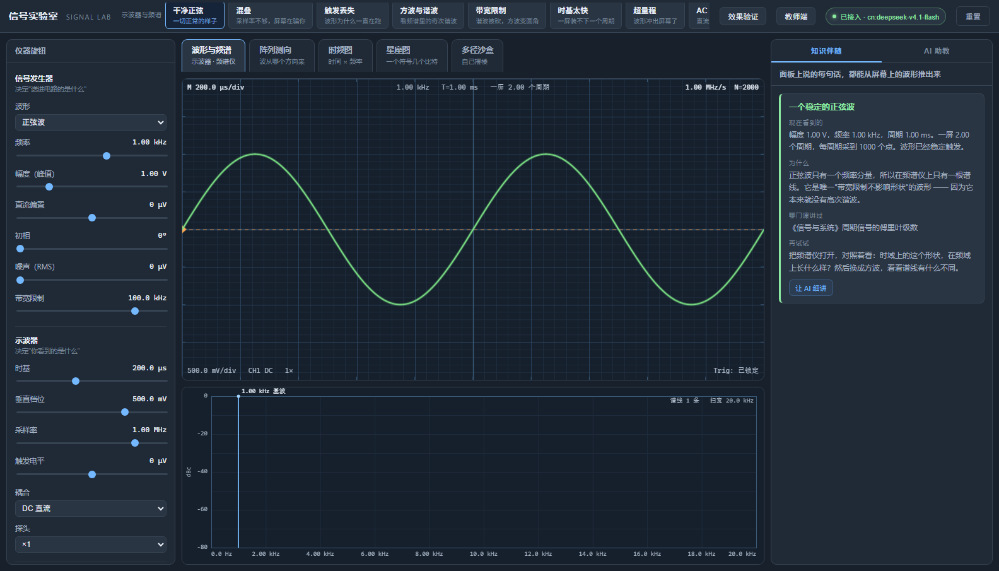
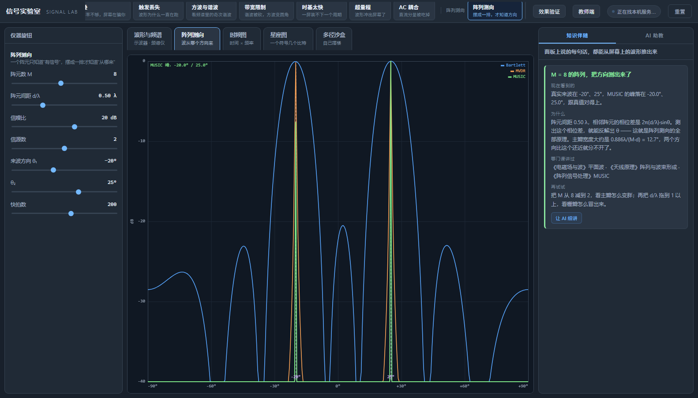
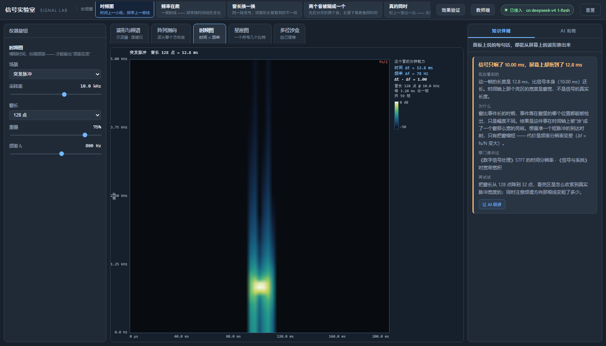
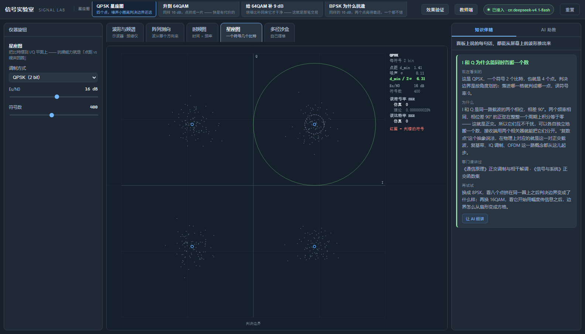
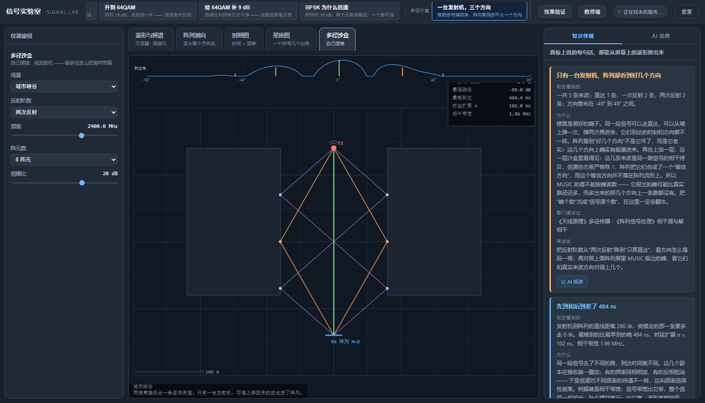

# 信号实验室 · Signal Lab

一个在浏览器里可以随便玩的电子实验室：**左边信号发生器造信号，中间虚拟示波器看波形，右边坐着一位懂行的助教，把眼前看到的现象和课本上的知识对上。**

参赛作品 · 浙客松 2026「AI+X 破界黑客松」校园赛道 · 自由命题（示例场景 **04 教育**）。

---

## 30 秒看懂这个项目

| | |
| --- | --- |
| **给谁用** | 电子信息类本科生（《信号与系统》《通信原理》《数字信号处理》《天线原理》）和他们的老师 |
| **解决什么** | 课本是公式、实验是黑箱 —— 示波器不会调、时域频域分不清、学完天线阵列不知道它有什么用 |
| **怎么做** | 浏览器里五台虚拟仪器（示波器与频谱 / 阵列测向 / 时频图 / 星座图）加一个多径沙盒，顶部页签一次只展开一台、只留那台仪器的旋钮；**学生先自己判，再对答案**；旁边坐着一位拿得到全部仪器状态的 AI 助教 |
| **凭什么信** | 每台仪器都跟教科书公式对过账（下面「验证」一节 657 项断言）；有带锚题的前测 / 后测；教师端能把全班的错法聚成知识点分布 |
| **怎么跑** | 双击 [`app/index.html`](app/index.html) —— 纯前端、零依赖、不联网、不要账号 |
| **数据口径** | 仓库里**所有成绩单都是合成数据**（[`pilot/`](pilot/)，固定种子可复现），不是真实学生。这一点在项目说明、报告首行、每份 JSON 里都主动写明 —— 详见下面「效果验证」一节 |



顶部五个页签，点哪台仪器就只展开哪台，左边的旋钮也跟着换成那台的 —— 跟真实仪器一样，一屏只有几个键。

| | |
| --- | --- |
|  |  |
|  |  |

## 现在能跑吗

能，而且分两种用法。

**只用仪器**：双击 [`app/index.html`](app/index.html) 就行 —— 纯前端、零依赖，不需要服务器，不需要联网，不需要装任何东西。

**连 AI 助教**：再多跑一个本机转发服务。中转站不响应 CORS 预检（`OPTIONS` 回 405），浏览器从 `file://` 打开时源是 `null`，带 Key 的请求会被直接拦掉，所以中间必须有一个本机代理：

```bash
python app/server.py            # 纯标准库，自动挑端口，自动开浏览器
```

接口地址、模型、Key 写在 `em-signal-lab/llm.local.json`（已 gitignore，不会进仓库）；也可以在界面右上角「接入模型」里现填，填了存在浏览器本地。别人 clone 下来只需要填自己的 Key。

想直接跳到某个现象，用直链：

```
app/index.html?preset=混叠
app/index.html?preset=带宽限制
app/index.html?preset=3          # 也支持序号
app/index.html?tab=ai            # 直接打开 AI 助教
```

二十五个预设，按仪器分五组 —— **页签切到哪台仪器，顶栏就只列那台仪器的预设**（所以一次最多看到 8 个）—— **示波器与频谱**：干净正弦 / 混叠 / 触发丢失 / 方波与谐波 / 带宽限制 / 时基太快 / 超量程 / AC 耦合；**阵列测向**：阵列测向 / 只有一个阵元 / 栅瓣 / 分不开的两个方向；**时频图**：时频图 / 频率在爬 / 窗长换一换 / 两个音被糊成一个 / 真的同时；**星座图**：QPSK 星座图 / 升到 64QAM / 给 64QAM 补 9 dB / BPSK 为什么抗造；**多径沙盒**：一台发射机三个方向 / 楼把直达挡死了 / 把反射关掉 / 密集楼群。

---

## 我们要解决的那个具体问题

按评审要求的「场景 → 用户 → 痛点 → 方案」四段式：

**场景** —— 电子信息类本科生在大一到大三之间有一条断裂带：

- 大一进实验室，示波器面板上一堆旋钮，不知道时基和垂直档位各管什么，波形永远在屏幕上跑
- 学《信号与系统》，傅里叶变换的积分算得出来，但**时域和频域到底是什么关系**说不清
- 学《电磁场与波》，天线阵列的导向矢量推得动，但**阵列到底解决了什么问题**答不上来
- 到《通信原理》《射频电路》，调制、噪声、增益各自独立成章，串不起来

**用户** —— 本科生（自学、预习、复习、考研）＋ 实验课主讲教师与助教。

**痛点**

1. **仪器是黑箱**：实验课时间有限，学生还没把旋钮搞明白就该下课了；课后没有仪器可练。
2. **知识是孤岛**：每门课从零讲抽象概念，学生从没在同一件真实事物上看见过它们。傅里叶在高数里是个积分，在信号与系统里是个变换，在通信原理里是频谱 —— 学生不知道它们是同一个东西。
3. **现象是理想的**：教材和 MATLAB 画的是理想正弦波，没有噪声、没有多径、没有干扰；学生到了真实频谱仪前发现「怎么跟书上不一样」。
4. **错误分布是隐形的**：教师批改一次报告要很久，看不到全班是在同一个地方集体卡住的。

**方案** —— 一个浏览器里的自由电子实验室。学生自己造信号、自己调仪器、自己看现象；**仪器面板是真的**：时基、垂直档位、触发电平、耦合方式、采样率，每一个都真实改变屏幕上的东西。把采样率调到信号频率两倍以下，屏幕上会出现一个频率完全不对的低频假波形 —— **学生亲眼看到混叠，比讲十遍采样定理管用**。

---

## 核心：仪器是真的

这是整个产品的底线。示波器不是画上去的装饰，它真的在按参数采集信号。

| 旋钮 | 屏幕上发生什么 |
|---|---|
| 时基 Time/div | 一屏显示的时间 = 10 × 时基。太快只看到一个点，太慢波形挤成一团 |
| 垂直档位 V/div | 纵轴标度。太小波形冲出屏幕（你看到的「平顶」是屏幕边缘，不是信号被削了） |
| 触发电平 | 波形从哪一点开始画。落在信号范围之外 → 找不到触发点 → 波形满屏乱跑 |
| 耦合 AC/DC | AC 在输入端串一个电容，直流过不去。量电平时用 DC，看纹波时用 AC |
| 采样率 fs | 决定采样密度。**fs < 2f 时出现混叠** |
| 探头 ×1/×10 | 探头里的 9 MΩ 和示波器 1 MΩ 分压，屏幕读数要乘 10 |

触发支路跟显示走同一套变换 —— AC 耦合隔直流、×10 探头衰减 10 倍，触发比较器看到的和屏幕上看到的是同一条信号。真实示波器就是这么接的。

**本实验台故意关掉了抗混叠滤波器**（真实示波器会先滤掉高频，那样就看不见混叠了）。这个取舍在知识面板里对学生明说了。

---

## 知识伴随面板

右侧面板说的每一句话，都能从屏幕上当前的波形推出来 —— 不是预先写好的文案，是规则实时算的。每条卡片固定四段：

> **现在看到的** → **为什么** → **哪门课讲过** → **再试试**

第三段就是「把课程串起来」：它会把现象指到《信号与系统》采样定理、《数字信号处理》第 1 章、《电子测量技术》示波器原理这样的具体位置。

二十五条规则。**时域频域十条**：混叠 / 触发未锁定 / 一屏不到一个周期 / 周期太多 / 采样点太少 / 超量程 / AC 耦合隔直流 / 探头衰减 / 带宽限制 / 一切正常。**阵列六条**：只有一个阵元 / 阵元数不够算不出 MUSIC / 栅瓣 / 两个方向分不开 / 快拍数太少 / 阵列测向正常。**时频五条**：双音先后被长窗糊成了同时 / 短脉冲被窗拖宽 / 调频信号背后的非平稳 / 两个音在频率上分不开 / 窗长的时间-频率折中。**星座四条**：噪声圆快碰到判决边界了 / 已经在判错了 / 高阶调制点太挤的这笔交易 / 星座图一切正常。

---

## 阵列测向：回答「天线阵列有啥用」

这是学生最初提的三个痛点里最难讲的一个。导向矢量的公式推得动，但「阵列到底解决了什么问题」答不上来。

所以这一屏的默认状态就是**只有一个阵元**：Bartlett 和 MVDR 都是 0 dB 的一条平线 —— 只知道「有信号」，不知道「从哪来」。把阵元数从 1 调到 8，谱上立刻长出峰。

面板上同时画三条谱，它们的差别本身就是教学内容：

| 谱 | 特点 | 什么时候会露馅 |
|---|---|---|
| **Bartlett**（蓝） | 常规波束形成，稳健但主瓣宽 | 两个方向靠得近时并成一个包 |
| **MVDR**（橙） | 自适应，主瓣窄、旁瓣低 | 快拍数太少时会不稳 |
| **MUSIC**（绿） | 子空间法，分辨率最高 | 阵元数 ≤ 信源数时，噪声子空间是空的，算不出来 |

三个可以直接演的现象：

- **栅瓣**：阵元间距调到 1.0λ，±30° 互为栅瓣 —— 谱上多出来的那个方向并没有信号源。这和采样定理的混叠是同一个道理：都是「间隔太大 → 出现假的复制品」。
- **瑞利限**：两个方向差 12° 时，Bartlett 分不开，MUSIC 分得开。
- **快拍数**：K < 2M 时协方差矩阵还没「平均」出来，谱线开始抖。

知识面板会按当前状态自动挑一张卡片出来讲，AI 助教也知道阵列的全部参数和三条谱各自的检出峰。
---

## 时频图：非平稳信号才有得看

频谱仪回答「有哪些频率」，答不了「什么时候有」。一个线性调频信号和一个双音同时信号，频谱上都是两根线；把时间轴加进来，一根是斜线，两根是两条平行的横线。

这一屏用短时傅里叶变换（STFT）：把信号切成若干帧，每帧乘窗后做 FFT，一列一列拼成图。

屏幕上同时标出三个数，它们的关系就是这个模块的全部内容：

| 符号 | 含义 | 公式 |
|---|---|---|
| Δt | 时间分辨率（每列代表多长时间） | Δt = N / fs |
| Δf | 频率分辨率（每行代表多少赫兹） | Δf = fs / N |
| — | 乘积 | Δt · Δf ≡ 1 |

窗长 N 是唯一的旋钮，而它只能二选一：**想让时间看得准，就得牺牲频率；反之亦然**。这就是《数字信号处理》里的时间-频率不确定性。

五个可以直接演的现象：

- **短脉冲**：信号只响了 10 ms。窗长 64 点时（Δt = 6.4 ms）能看出它的边界；窗长 512 点（Δt = 51.2 ms）就被拖宽成了一个窗那么宽的亮斑 —— 屏幕上看到的宽度是窗宽，不是信号的真实长度。
- **线性调频**：一根斜线。频率随时间线性变化，斜线的斜率就是调频斜率。
- **双音先后 vs 双音同时**：同样两个频率、同样的总时长。窗长 64 点时一个是中间有间断的两段、一个是贯通的（两种情况的相关系数分别是 −0.996 和 +0.998，一眼可分）；窗长 512 点时**两张图几乎一模一样**。这是最有冲击力的一张对照 —— 频率分辨率换来的是时间上再也分不开。
- **频率分辨率**：Δf = fs / N。两个音隔得比 Δf 还近时，谱上就并成一根了。
- **帧间距**：重叠率决定相邻帧隔多远（0% = 不重叠，75% = 每次只往前挪 1/4 窗）。挪得越密越平滑，代价是算得更久。

知识面板会按当前状态挑一张卡片讲，AI 助教的 brief 里也带上 Δt、Δf 和当前场景的真值。

---
## 星座图：一个符号能塞几个比特

前面几屏都在看「波形长什么样」。这一屏换个问法：**要传更多比特，代价是什么？**

星座图把每个符号画成 I-Q 平面上的一个点。BPSK 两个点、QPSK 四个、8PSK 八个、16QAM 十六个、64QAM 六十四个 —— 同样一份发射功率，点越多，每符号带的比特越多（1 / 2 / 3 / 4 / 6 bit），但点与点之间挨得越近。

接收端的噪声会把每个点推成一个云团。判决规则是「离谁近算谁」，判决边界就是相邻两点的中垂线 —— 屏幕上那几条格子线就是它。噪声圆一旦碰到边界，就会判错。

| 量 | 公式 | 含义 |
|---|---|---|
| 每维噪声 σ | σ = √(1/(2γ))，γ = 10^(Es/N0 ÷ 10) | 点被推离理想位置多远 |
| 最小点距 d_min | 所有点对里最近的那一对 | 点挨得多紧 |
| 判决裕量 | d_min ÷ (2σ) | 噪声圆半径是半个点距的几倍 |

`d_min / (2σ)` 这一个数就决定了这一屏的一切：

- **远大于 1** → 云团是几个清楚的小点，判决全对。
- **约等于 1** → 噪声圆快碰到边界了，开始零星判错。
- **小于 1** → 云团糊成一片，判错的点（红圈）比对的还多。

屏幕右侧同时给出仿真与理论的误符号率。理论值用的是教科书闭式解（M-PSK 和方阵 M-QAM 各一条）。**两行数字必须对得上** —— 这不是装饰，是给仿真代码上的枷锁：`constellation_smoke.js` 里每一档信噪比都要求实测错误数落在理论期望值的 4σ 内。

四个可以直接演的现象：

- **同样是 16 dB**：QPSK 一点不乱，64QAM 已经错了 27%。把信噪比一档一档往下拉，能亲眼看到「点越多、垮得越早」。
- **补 9 dB 换回干净**：64QAM 拉到 25 dB，云团重新收成小点。这 9 dB 就是 6 bit/符号的那笔账。
- **BPSK 为什么抗造**：两个点摆在 ±1，点距是 QPSK 的 √2 倍。同样的信噪比下它一个都不错，代价是一半的速度。
- **理论对仿真**：把符号数从 400 拉到 4000，仿真值会越来越贴近理论值 —— 这是蒙特卡洛收敛，也是「样本量」这件事最直观的一次演示。

知识面板里有四张卡分别管「噪声圆快碰边界」「已经在判错」「高阶调制这笔交易」「一切正常」，AI 助教的 brief 里也带上实测的 SER / BER 和 `d_min / (2σ)`。

---
## 多径沙盒：一台发射机，为什么测出三个方向

前面四块屏的信号都是「算好给你看的」。沙盒不一样 —— **楼可以摆、发射机可以拖、阵列可以拖**，几何一变，路径当场重算。

引擎是纯 JavaScript 的二维几何光学，不调任何第三方库：

- **镜像法**做 1～2 阶镜面反射。发射机关于墙面做镜像，镜像点与接收机的连线与墙的交点就是反射点 —— 这不是近似，是镜面反射的定义。
- **垂直极化菲涅尔系数** `Γ⊥ = (cosθᵢ − √(εr − sin²θᵢ)) / (cosθᵢ + √(εr − sin²θᵢ))`，混凝土取 εr = 5.5。法向入射 Γ ≈ **−0.402**，掠入射趋近 **−1**。负号意味着**相位翻转** —— 多径为什么会互相抵消就在这个负号上。
- **自由空间路损** `λ/(4πL)`，每段时延 `τ = L/c`，路径幅度按路长衰减。
- 遮挡用矩形裁剪逐段判；**收发必须同在反射墙的一侧**反射才算数（分居两侧就是穿墙，不是弹墙）。

沙盒要回答的教学问题只有一个：**阵列量的不是「发射机在哪」，而是「信号从哪个方向来」。**

- **城市峡谷**：一台发射机、两排楼，出来 **5 条路径**（1 直达 + 2 个一次反射 + 2 个二次反射），反射方向对称地落在 ±30° 与 ±49°。
- **街角（挡住了）**：直达被楼挡死，只剩一条侧面楼上的反射。发射机真实方位 0°，**阵列报出来是 43°** —— 差的这 43° 就是城市里非直视传播定位误差的来源。
- **把反射关掉**：退回开阔地做对照，方向立刻跳回真值。
- **密集楼群**：时延扩展上去，相干带宽掉下来。

`Δτ` 与相干带宽 `Bc = 1/(5σ_τ)` 在右侧实时读出：峡谷里 σ_τ = 102 ns、Bc = 1.96 MHz —— 比 20 MHz 的 Wi-Fi 信道窄一个数量级，所以「频率选择性衰落」不是一个抽象名词，是一个能算出来的数。

这里有一个反直觉的点，而且是**实测**过的：**相干多径会让 MUSIC 报出根本没有路径的方向，Bartlett 不会。**

五条多径是同一路信号的相干拷贝、共用同一串样值，所以信源协方差是**严格秩 1** 的（信噪比 60 dB 时特征值实测就是 `0,0,0,0,0,0,0,1`）。阵列把这 5 个方向合成了一个**等效导向矢量** `a_eff = Σ gₖ·e^(jφₖ)·a(θₖ)`，它不等于任何一个真实角度的导向矢量。MUSIC 问的是「哪个角度的导向矢量最接近这个等效方向」，而和这个合成矢量近乎平行的角度**不止一个** —— 谱上于是长出好几个尖峰。

实测（城市峡谷、M = 8、d = 0.5λ、400 快拍）：真实来波是 0°、±29.7°、±48.8° 五个方向，MUSIC 报出的峰里多出一个 **+68.5°**，那里没有任何路径，离最近的路径还差 19.7°，是瑞利限（12.7°）的 1.5 倍。把信噪比从 20 dB 拉到 60 dB 它不消失；把声明的源数从 1 改成 5 也没用（变成两个假峰）——**秩亏是数据本身的性质，不是源数填错**。

把「报出的峰离所有真实来波方向都超过瑞利限」记作假峰，本次扫描的 **117 次运行**（两种反射阶数 × 三档阵元数 × 三档信噪比 × 多档快拍数 × 多个种子）里：MUSIC **每次都至少有一个假峰**；Bartlett **一次都没有**（代价是 ±48.8° 那两条弱路径它分不出来，只报出 0° 与 ±29.7°）。所以结论不是「MUSIC 只认一个源、把方向平均掉」，而是 —— **相干多径下 MUSIC 的谱不能按峰读数**：峰数不等于路径数，峰的位置也不保证真有一条路。这不是 bug，是子空间法的适用条件被破坏了。

知识面板里有四张沙盒卡：直达被挡、多径让方向变多、先到和后到差了多久、以及一切正常。

---
## AI 助教

知识伴随面板是规则算的，AI 助教是模型答的。它不是凭空聊天 —— 每次提问，`llm.js` 会把当前仪器状态拼成一段文字塞进 system prompt：

- 信号发生器与示波器的**全部参数**
- 这次采集的**真实结果**：一屏时长、实际采样点数、采样间隔、周期数、每周期采样点、触发是否锁定、是否削顶、直流是否被去掉
- **关键推导**：fs/2 与折叠公式 `|f0 − round(f0/fs)·fs|` 的数值结果
- 面板此刻正在提示哪张卡片
- **学生最近动过哪几个旋钮**（新旧值）

所以模型能说出「你刚把采样率从 1 MHz 拉到 1.50 kHz」这种话 —— 它有操作历史。system prompt 里写死了七条约束，核心是：只用给定数字、**不许编造教材章节号**、先讲现象再讲原理、不直接甩答案。

面板顶部有状态 chip（已接入 / 未接入），点「接入模型」可以改接口地址、模型名、Key、温度。设置弹窗里的「测试连接」会真发一条消息，并把耗时和转发方式报出来。

## 效果验证：凭什么说学生学会了

教学类作品最容易滑向的失败模式是「演示很好看，但没有证据说明学生真的学会了」。所以实验台里内置了一套前测 / 后测，点顶栏的**效果验证**就能跑。

10 道单选题，覆盖时域基本量、采样定理、频谱与谐波、示波器操作、阵列测向五块。**每道带图的题，图都是用实验台自己的绘图函数渲染的** —— 学生在仪器上看到什么，考卷上就是什么（`clean: true` 会关掉直接写出答案的标注）。

前测和后测是同一份蓝图的两套卷子：**6 道平行题换了数字，4 道锚题一字不差**。

锚题是这套设计里最关键的一环。只比较「前测平均分」和「后测平均分」有一个致命的混淆变量 —— 你没法排除「后测那套恰好更容易」。锚题把两套卷子钉在一起，难度变化才有得讨论。这不是严格的等量等值设计，但对一个三天的作品来说，**「有没有锚题」是分水岭**。

汇总页同时给出独立样本对比和**配对明细**（同一个代号的前测 / 后测配起来），并且明写着：前者不能当教学效果，要看效果只看配对明细。这套协议证明不了什么也写在文档里 —— 样本小、不是 RCT、测的是选择题不是动手能力、没有延迟后测。

完整协议见 [`docs/效果验证协议.md`](docs/效果验证协议.md)。

## 教师端：把「谁错了」变成「哪个知识点错了」

学生做完题点**交给老师**，得到一个 `.json`。老师点顶栏的**教师端**，把一堆 json 拖进**看全班**，看到的是：

- 收到几份、几个代号、前测几份、后测几份、**配对了几个人的提升**；
- 每一块知识点的**前测 / 后测正确率**与提升幅度；
- **最集中的卡点**：不是「第 3 题错的人多」，而是「第 3 题 8 个人都选了同一个错误选项，讲解在说……」—— 错法本身就是诊断信息。

点**导出诊断文字**会生成一段可以直接贴进备课笔记的纯文本。

**出练习**页签是另一半：勾知识点、勾层次（基础 / 进阶 / 挑战）、拉题量，点生成，得到一份带图的 A4 试卷 + **一份单独印的答案与讲解页**。卷子上的图和答案和实验台里是同一套代码算的 —— 学生做练习时看到的画面，和他自己拧旋钮时看到的完全一致。

页面上会实时显示**当前条件下最多能出多少道不重样的题**，选得太窄就不会给你一份重复的卷子。
---
## 试点数据：先证明工具跑得通

真试点要拉一个班做前测 / 教学 / 后测，周期以周计。在这之前，[`pilot/`](pilot/) 里放了一份**可复现的仿真队列** —— 88 份成绩单，题目是真的（取自 `quiz.js` 的真题面），答题的人是假的（`make_cohort.js` 用固定种子生成，每份 JSON 里都写着「合成数据，非真实学生」）。

它刻意编出了真实课堂里一定会有的三类人：6 个人只交了前测就再没出现（前测平均只有 33.3%）、6 份匿名卷配不上对、2 个人没有前测。于是「前后测平均分直接相减」得到 +14 个百分点，而**只算能配对的 38 个人**是 +11.3 个百分点 —— 差的这 2.7 个点不是舍入误差，是掉队的人被算进了前测分母。教师端的报告会把这个坑直接点出来。

生成与校验：`node pilot/make_cohort.js && node pilot/verify_cohort.js`（44 项断言，顺便写出 `pilot/报告样例.md`）。

⚠️ **这份数据证明的是「工具跑得通」，不是「学生学得好」。** 它可以当运行演示用，不能引用为教学效果的证据。真试点按 [`docs/效果验证协议.md`](docs/效果验证协议.md) 拉人。

**口径已拍板：主动写明。** 项目说明（`bpFileId`）、演示视频、答辩问答里只要提到试点数据，一律写明是合成数据。可直接引用的一句话：

> 效果验证目前提供的是**可复现的仿真试点队列**——88 份成绩单，种子固定、可重跑、可核查，用来验证「出题 → 收卷 → 配对统计 → 错因分布 → 导出」这条链路。它**不构成教学效果的证据**。真人前测 / 后测按本仓库 `docs/效果验证协议.md` 进行，完成后会如实替换。

理由：这作品的技术主张是「每条结论都带证据、带不确定性」。数据来源上含糊一句，主张就自相矛盾了。

教师端拿到这批文件时会自己认出那个 `synthetic: true` 标记，在报告顶上弹一条橙色告示：**「这批成绩单里有 1 份自报『合成数据，非真实学生』……不能当作教学效果的证据」**。这条告示不是截图时手画的，是 `readRecords` 一份份数出来的 —— 效果见 [`docs/img/lab-teacher-class.png`](docs/img/lab-teacher-class.png)。

## 关键实现决定

1. **波形用截断傅里叶级数算，不是画出来的。** 方波 = 奇次谐波叠加。把「带宽限制」调低，高次谐波被真的砍掉，方波在时域上就真的变圆角。时域和频域是同一个东西的两种看法 —— 在代码里，它就是同一个 `kMax`。
2. **采样是真的。** 示波器以 fs 对 s(t) 采样，一屏采 N = 10·时基·fs 个点。fs < 2f 时屏幕上出现的波形是**算出来的**，不是动画。
3. **频谱用整周期同步 DFT。** 信号严格周期，采一个完整周期做 DFT，第 k 根谱线正好是第 k 次谐波 —— 这是精确的傅里叶系数，不是近似。所以方波的基波幅度能和理论值 4/π 对上。
4. **离线优先。** 实时信号合成和频谱都是纯 JavaScript，断网、无服务器也能跑完整演示。城市多径等重计算场景留给后续的离线题库。
5. **星座图的仿真有一个外部裁判。** 误符号率不是拍脑袋给的，而是拿教科书闭式解当场对账（M-PSK 与方阵 M-QAM 各一条）。模块里那个 `serTheory` 不是装饰：测试要求每一档信噪比下实测错误数都落在理论期望值的 4σ 内，整条瀑布曲线跑一遍。没有这个裁判，蒙特卡洛代码写错一个 σ 因子是看不出来的 —— 云团依旧长得像那么回事，SER 却错了 3 dB。
6. **多径沙盒不引第三方射线追踪。** 成熟的射线追踪方案（Sionna RT）要 Python 3.12 + Mitsuba + 一整套独立虚拟环境，把它拉进来就等于放弃「双击即用」这条唯一的护城河。所以沙盒自己写了二维镜像法 + 菲涅尔系数 + 矩形遮挡：物理是真的（法向入射 Γ = −0.402、掠入射 → −1、入射角恒等于反射角，都在 112 项测试里对过），代价是只做二维、只做到 2 阶反射。对「多径为什么会让测向失效」这一个教学点，够了。
---

## 目录

| 路径 | 内容 |
|---|---|
| [`app/index.html`](app/index.html) | 应用入口，双击即用 |
| `app/js/signal.js` | 信号模型层：波形合成、触发、示波器采集 |
| `app/js/fft.js` | 频谱分析：radix-2 FFT、谐波谱、THD |
| `app/js/scope.js` | 示波器绘制：10×8 格屏幕、迹线、读数 |
| `app/js/spectrum.js` | 频谱仪绘制：线谱、fs/2 与带宽限制标记 |
| `app/js/advisor.js` | 知识伴随面板：30 条规则，四段式卡片 |
| `app/js/array.js` | 阵列测向：均匀线阵、Bartlett / MVDR / MUSIC 空间谱 |
| `app/js/timefreq.js` | 时频图：STFT、三种窗、Δt/Δf 折中、五个场景的真值 |
| `app/js/constellation.js` | 星座图：五种调制的映射与格雷码、AWGN、最近点判决、SER/BER 仿真与理论闭式解 |
| `app/js/sandbox.js` | 多径沙盒：镜像法 1～2 阶反射、菲涅尔系数、自由空间路损、遮挡判定、时延扩展与相干带宽 |
| `app/js/main.js` | 界面装配、参数表、预设、渲染循环 |
| `app/js/llm.js` | 模型接入：探测本机服务、拼仪器状态、SSE 流式解析 |
| `app/js/tutor.js` | AI 助教面板：对话、设置弹窗、状态 chip |
| `app/js/quiz.js` | 前测 / 后测出题引擎：平行卷 + 锚题、判分、汇总、CSV 导出、题目配图 |
| `app/js/quizui.js` | 效果验证界面：封面 / 答题 / 成绩 / 汇总四个视图；成绩页可「交给老师」导出 JSON |
| `app/js/teacher.js` | 教师端引擎：分层抽题、试卷与答案页生成、班级汇总与卡点归因 |
| `app/js/teacherui.js` | 教师端界面：出练习 / 看全班两个页签，支持拖入学生 json |
| [`app/server.py`](app/server.py) | 本机转发服务（纯标准库）：静态托管 + `/api/chat` |
| `app/test/smoke.js` | 离线冒烟测试，49 项断言 |
| `app/test/array_smoke.js` | 阵列离线测试，34 项断言 |
| `app/test/llm_live.js` | 真连模型的端到端测试，10 项断言（需 server.py 在跑） |
| `app/test/quiz_smoke.js` | 题库离线测试，52 项断言 |
| `app/test/timefreq_smoke.js` | 时频图离线测试，94 项断言 |
| `app/test/teacher_smoke.js` | 教师端离线测试，99 项断言 |
| `app/test/constellation_smoke.js` | 星座图离线测试，217 项断言 |
| `app/test/sandbox_smoke.js` | 多径沙盒离线测试，112 项断言 |
| `app/test/shot.js` | CDP 驱动无头 Chrome：能点能截图的截图工具 |
| [`PLAN.md`](PLAN.md) | 产品规划 v0.7（§0 是当前实现状态） |
| `docs/img/` | 进仓库的界面截图（五台仪器 + 教师端全班报告 + 测验成绩页） |
| `shots/` | 本机截图草稿目录（已 gitignore，演示前重新生成即可） |
| [`docs/效果验证协议.md`](docs/效果验证协议.md) | 前测 / 后测的设计、跑法、数据怎么读、证明不了什么 |
| [`docs/演示脚本.md`](docs/演示脚本.md) | 现场 8 分钟逐屏脚本、3 分钟录屏版、三个高频追问、翻车清单 |
| [`docs/项目说明.md`](docs/项目说明.md) | 报名表 `bpFileId` 的底稿：四段式 + 数据口径 + 提交信息核对 |
| [`docs/`](docs/) | 设计文档、教学脚本、报名底稿 |
| [`pilot/`](pilot/) | **仿真试点队列**（合成数据，非真实学生）：88 份成绩单 + 生成器 + 44 项校验 + 报告样例 |
| [`submission/`](submission/) | 提交材料：商业计划书 PDF 与渲染脚本、提交清单、ModelScope 卡片 |

---

## 验证

```bash
node app/test/smoke.js        # 离线，49 项
node app/test/array_smoke.js  # 离线，34 项
node app/test/quiz_smoke.js   # 离线，52 项
node app/test/timefreq_smoke.js # 离线，94 项
node app/test/teacher_smoke.js  # 离线，99 项
node app/test/constellation_smoke.js # 离线，217 项
node app/test/sandbox_smoke.js # 离线，112 项
python app/server.py          # 另开一个窗口
node app/test/llm_live.js     # 真连模型，10 项
```

**离线 657 项 + 联网 10 项，全过。** 时域频域那 49 项覆盖：

- 信号链：一屏周期数、每周期采样点数、采样点数 N
- 混叠：1 kHz @ 1500 Sa/s 折叠到 500 Hz，从屏幕上的过零点反推频率也对得上
- 触发：电平超出信号范围时不触发；自由运行时时间原点每帧在动
- 谐波：方波基波幅度 = 4/π，3 次谐波 = 1/3，偶次谐波 ≈ 0
- 带宽限制：4000 Hz @ 1 kHz 时只保留 4 次谐波，5 次被砍掉
- 耦合与探头：AC 后均值归零；×10 探头把电压压到 1/10；触发支路跟着一起变
- 五种波形 × 三种占空比无 NaN

阵列那 34 项覆盖：单阵元谱为平、MUSIC 峰位、栅瓣位置与高度、两个方向差 12° 时 Bartlett 分不开而 MUSIC 分得开、瑞利限 0.886λ/(M·d)、主瓣宽度随 M 变窄、快拍数、种子可复现，以及六张阵列卡片各自在什么条件下触发。
时频图那 94 项覆盖：Δt · Δf ≡ 1 恒成立、三种窗的相干增益都归一化到 1、五个场景的真值、线性调频的峰值频率逐列单调上升、短脉冲在长窗下被拖宽而短窗下不糊、双音先后在长窗下真的糊成同时（窗长 512 点时与双音同时的图已经分不出来）、两个音隔得比 Δf 近时分不开、噪声抬高底噪、抽稀后的列数与时长一致，以及五张时频卡片各自在什么条件下触发。

题库那 52 项覆盖：两套卷子各 10 题、五块知识点各 2 题；平行题的题干 / 选项 / 答案在前后测之间确实不同；**锚题在前后测之间完全一致**（题干、选项、正确答案文本）；判分（全对 10/10、全错 0/10、全空 0/10 且标为未作答）；每道带图的题都能真的画出图；CSV 导出格式；无 localStorage 时不崩。

教师端那 99 项覆盖：分层抽题的题目数不会超过可选池；**每道题至少 3 个选项且不重复**（干扰项跟正确答案撞车会被去重，真出过只有两个选项的题，已补兜底项）；知识点与层次的分布统计和实际题目一致；试卷 HTML 里每道题都带编号与答题线；答案页逐题给出字母 + 知识点 + 层次；班级汇总的前后测配对只认同一代号的同卷别记录；最常见的错法确实是被选得最多的那个选项；CSV 与诊断文字的非空字段。
星座那 217 项覆盖：五种调制的点数与每符号平均能量都归一化到 1；格雷码相邻仅差 1 bit；最近点判决与暴力穷举一致；`d_min/(2σ)` 随信噪比单调；**每一档信噪比下实测错误数都落在理论期望值的 4σ 内**（整条瀑布曲线、含全部五种调制）；BPSK 与 QPSK 的仿真 SER 分别对上各自的闭式解；高信噪比下零错、低信噪比下接近全错；符号数夹在 8…4000；同种子可复现；抽稀（sweep）与逐点结果一致；四张知识卡片各自在什么条件下触发、任何调制 × 任何信噪比下文字都不含 NaN；提示词里的【星座】段含实测 SER/BER 与 `d_min/(2σ)`。
沙盒那 112 项覆盖：镜面反射的四项几何自检（**入射角恒等于反射角**、镜像点／反射点／接收机共线、反射点到发射机的距离等于到镜像点的距离、路径长度等于各段之和）；法向入射 Γ = −0.402、掠入射 → −1；自由空间路损 1/L（距离减半幅度翻倍、-6 dB）与频率减半少 6 dB；到达角映射 −asin(v·e)（正前方 0°、右手边负角、左右对称）；四个场景的路径数、阶数、方向与正负号（**一次反射 Γ<0 为负、弹两次翻回正号**）；街角真实方位 0° 而报出 43°；`maxOrder` 开关；发射机被拖进楼里时直达算作被挡；同种子可复现、同输入同结果；把几何喂给阵列后 `S = declared = 1`（五条相干多径只声明一个源）、噪声子空间按声明的源数算、**一台发射机在 Bartlett 谱上却不止一个峰**；格式化函数对 Infinity / NaN 给破折号；所有读数里没有 NaN / undefined。
二十五个预设（分五组）、阵列三条谱、时频图五个场景、星座图五种调制、多径沙盒四个场景（含拖动与 DOA 条），AI 面板与设置弹窗、效果验证的四个视图、教师端的出练习（试卷 / 答案页）与看全班（24 份合成记录），都在 Chrome 里截图核对过（`shots/tch-make.png`、`tch-sheet.png`、`tch-key.png`、`tch-class.png`、`con-errors.png`、`con-topbar.png`、`sb-zoom-canyon.png`、`sb-zoom-corner.png`）。

联网那 10 项走的是和浏览器完全相同的代码路径（`llm.js` 的探测、拼状态、发请求、解 SSE）。用「采样率拧到 1500 Sa/s」的状态真问一次，模型答出了 500 Hz 折叠频率、666.7 µs 采样间隔、每周期 1.5 个采样点，并且注意到「你刚把采样率从 1 MHz 拉到 1.50 kHz」。

---

## 这个项目是自包含的

一个第三方依赖都没有：信号链、触发、混叠、频谱与谐波、阵列三条谱、时频图的窗长权衡、星座图的格雷映射与判决、多径的镜像法、出题与判卷、统计与 CSV 导出 —— 全部是自己写的原生 JavaScript 加 Canvas。不引框架、不引 CDN、不引任何 Python 引擎。

这不是洁癖，是为了让它能落在考场一样的机器上：高校机房的电脑常常没装 Node、没装 pip，浏览器还是旧版本。浏览器直接打开 `app/index.html` 就能跑，断网也能跑（只有 AI 助教需要那个本机中转服务）。

代价是每一样都得自己写对。所以物理不靠「引用谁」，靠测试里跟解析式对账：入射角恒等于反射角、自由空间路损按 1/L、时频图的 Δt·Δf 恒等于 1、星座图的 SER 落在理论值的 4σ 内。657 项离线测试里有大半是这种对账。


